<p align="center">
  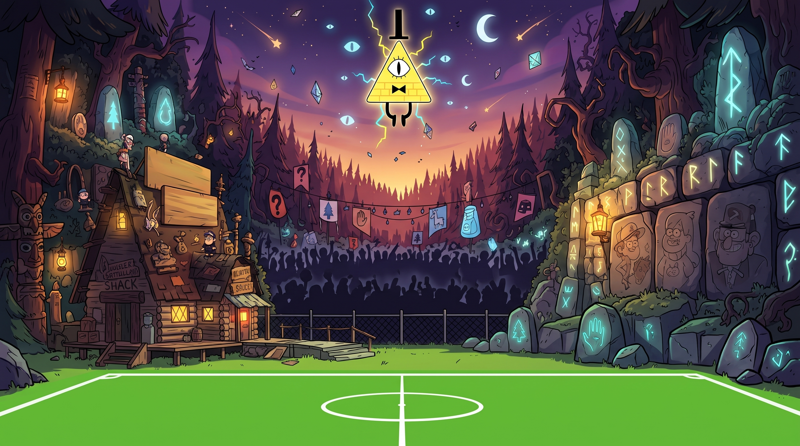
</p>

<h1 align="center">⚽ POOBSoccer ⚽</h1>

<p align="center">
  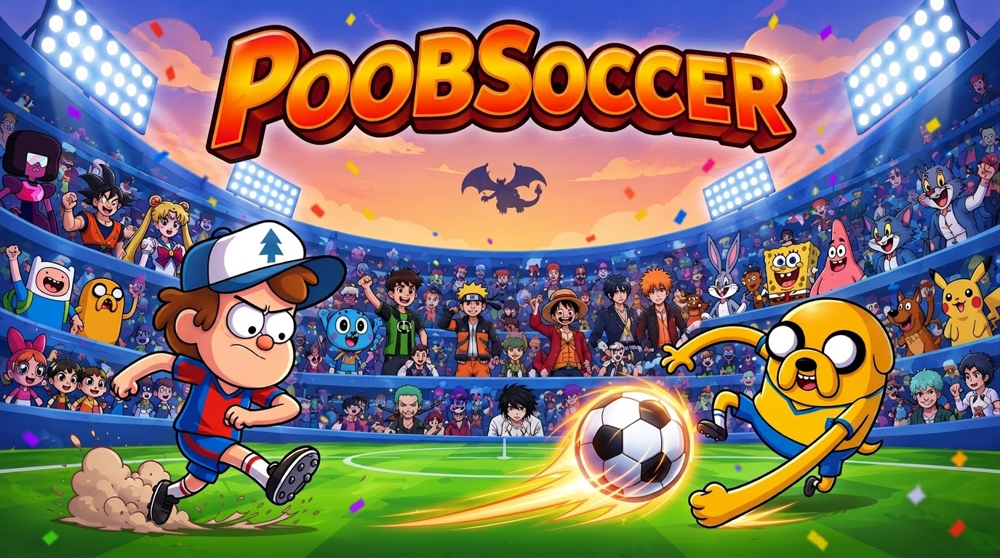
</p>

<p align="center">
  <b>Cabezas grandes, poderes locos y un solo objetivo: meter más goles que tu rival.</b><br>
  Fútbol 2D uno contra uno hecho 100% en Java con Swing.
</p>

<p align="center">
  
  
  
  
  
</p>

<p align="center">
  <a href="#-cómo-ejecutarlo">Ejecutar</a> ·
  <a href="#-los-personajes">Personajes</a> ·
  <a href="#-los-poderes">Poderes</a> ·
  <a href="#-juega-contra-la-máquina">Máquina</a> ·
  <a href="#-la-tienda-de-mejoras">Tienda</a> ·
  <a href="#-cómo-está-hecho">Código</a>
</p>

---

## 🎮 ¿De qué se trata?

POOBSoccer es el proyecto final del curso de **Desarrollo Orientado por Objetos (DOPO)** de la Escuela Colombiana de Ingeniería Julio Garavito.

Escoge tu personaje, entra a la cancha y demuestra quién manda: patea, salta, carga tu barra de poder y lanza un tiro especial que deja a tu rival electrocutado, volando por los aires o viendo balones por todos lados. Juega con un amigo en el mismo teclado o enfréntate a la máquina.

> Todo el motor de física (gravedad, rebotes, choques con los postes y contacto entre jugadores y balón) está hecho a mano, sin librerías de juegos.

<p align="center">
  
</p>

## 🕹️ Elige cómo jugar

<table align="center">
  <tr>
    <td align="center">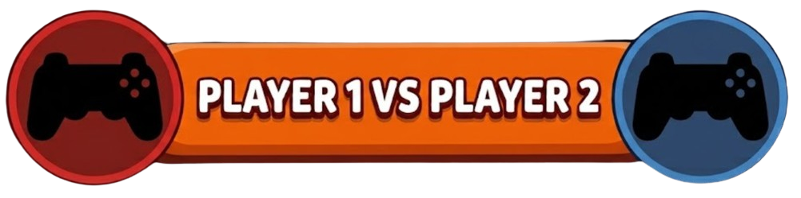<br><b>Jugador vs Jugador</b><br>Dos personas, un teclado</td>
    <td align="center"><br><b>Jugador vs Máquina</b><br>Cuatro perfiles de dificultad</td>
  </tr>
</table>

<p align="center">
  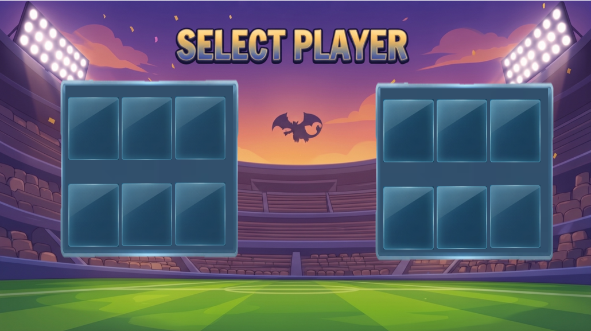
</p>

## 🧑‍🎤 Los personajes

<table align="center">
  <tr>
    <td align="center">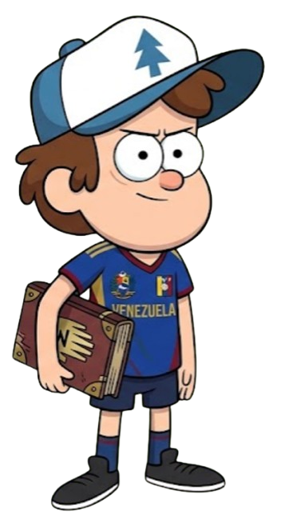<br><b>Dipper</b></td>
    <td align="center">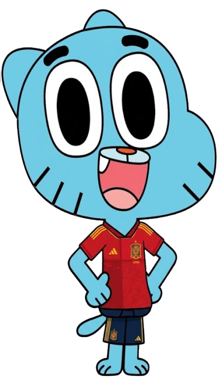<br><b>Gumball</b></td>
    <td align="center">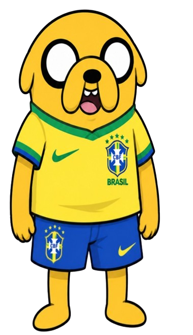<br><b>Jack</b></td>
    <td align="center">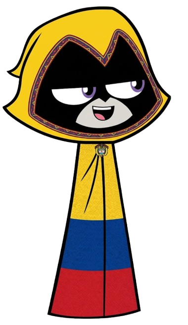<br><b>Raven</b></td>
    <td align="center">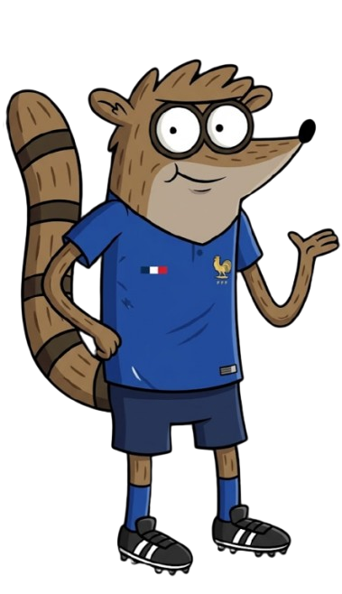<br><b>Rigby</b></td>
  </tr>
</table>

Cada uno patea con su propia animación y se voltea según hacia dónde camina:

<table align="center">
  <tr>
    <td align="center">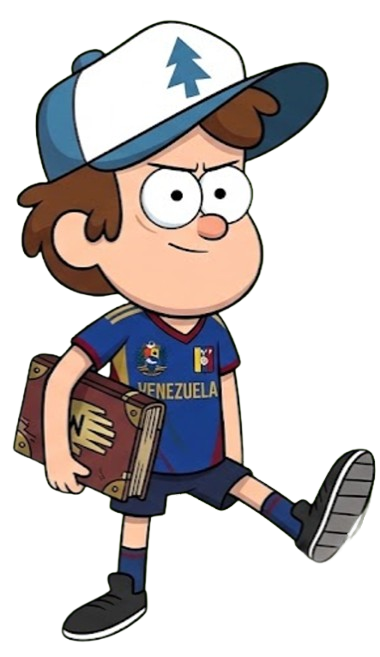<br>Patada</td>
    <td align="center">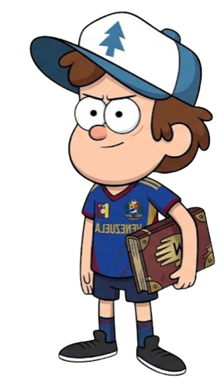<br>Mirando a la izquierda</td>
    <td align="center"><br>Con el aura del poder</td>
    <td align="center">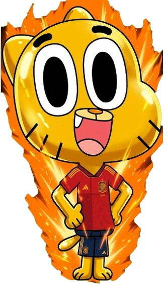<br>Gumball con aura</td>
    <td align="center">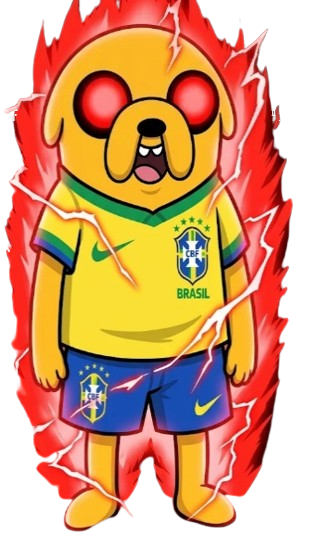<br>Jack con aura</td>
  </tr>
</table>

## ⚡ Los poderes

Cada personaje tiene su propio poder. La barra se llena con el tiempo, y **recibir un gol la sube un cuarto**: el que va perdiendo siempre tiene una oportunidad.

<p align="center">
  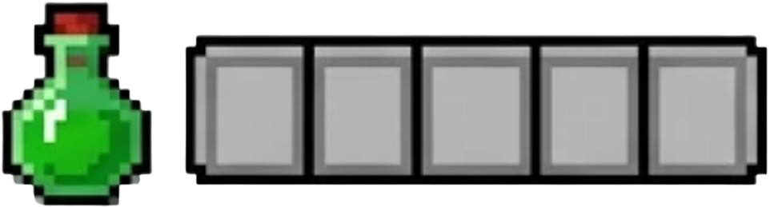 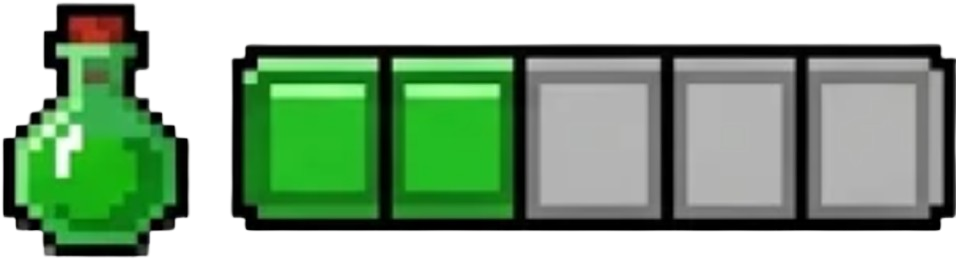 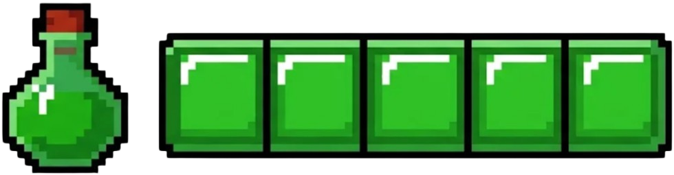
  <br><i>La barra de poder, de vacía a llena</i>
</p>

| Personaje | Poder | Qué le hace al rival |
|-----------|-------|----------------------|
| **Dipper** | 🔵 Blue Aura | Un tiro recto y veloz que lo empuja hasta su propio arco |
| **Gumball** | ⚡ Ray | Lo electrocuta: va a media velocidad y no puede saltar |
| **Jack** | 🌪️ Tornado | Un tiro por el suelo que lo lanza al aire y lo deja inconsciente |
| **Raven** | 🔮 Illusion | Aparecen 7 balones falsos para confundirlo |
| **Rigby** | — | Sin poder, solo habilidad |

<table align="center">
  <tr>
    <td align="center"><br><b>Rayo</b><br>sobre el jugador electrocutado</td>
    <td align="center">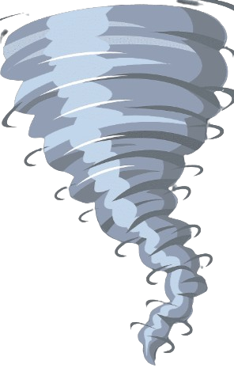<br><b>Tormenta</b><br>bajo el jugador del Tornado</td>
  </tr>
</table>

Y un detalle importante: **un tiro de poder siempre le llega al rival**, aunque esté pateando.

## 🤖 Juega contra la máquina

Cuatro perfiles, cada uno con su personalidad:

<table align="center">
  <tr>
    <td align="center"><br><b>Clumsy</b><br>Se mueve al azar</td>
    <td align="center">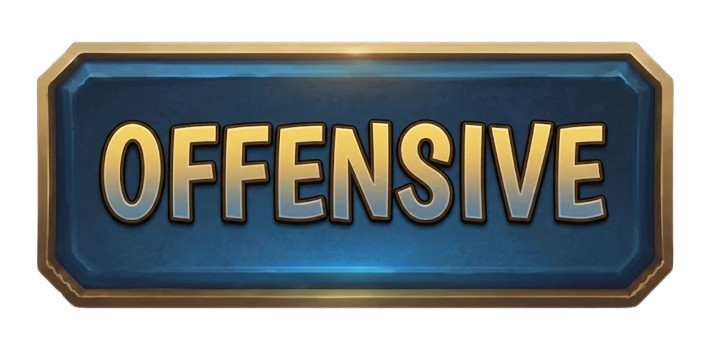<br><b>Offensive</b><br>Siempre va por el balón</td>
    <td align="center">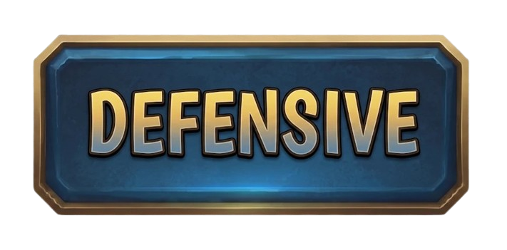<br><b>Defensive</b><br>Cuida su arco</td>
    <td align="center"><br><b>Expert</b><br>Lee el partido y decide</td>
  </tr>
</table>

El **Expert** mira el marcador, el tiempo y las posiciones: ataca cuando va perdiendo o en muerte súbita, y se encierra a defender cuando va ganando o cuando el rival está a un gol de ganar.

## 🏟️ Todo para personalizar tu partido

### Tres estadios, tres gravedades

<table align="center">
  <tr>
    <td align="center"><br><b>Estadio 1</b><br>Gravedad normal</td>
    <td align="center">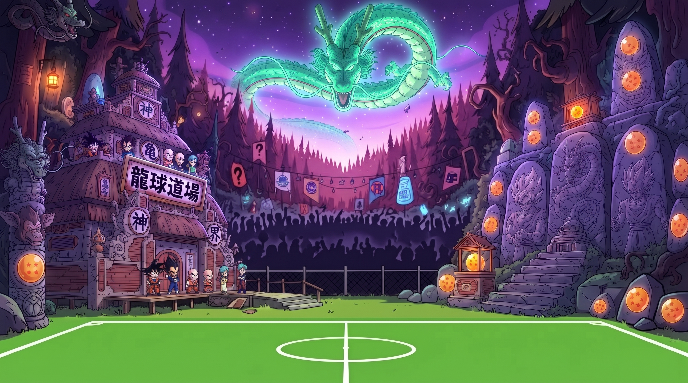<br><b>Estadio 2</b><br>Gravedad baja: saltas muy alto</td>
    <td align="center">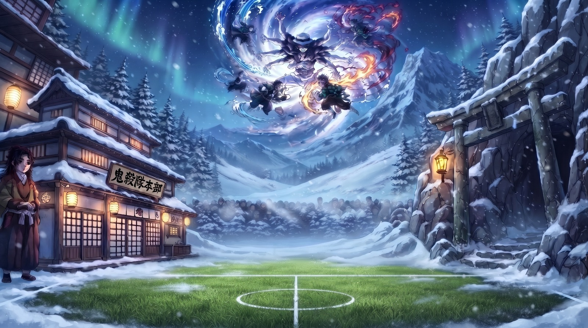<br><b>Estadio 3</b><br>Gravedad alta: casi no despegas</td>
  </tr>
</table>

### Cuatro balones

<p align="center">
  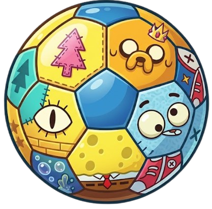 &nbsp;
  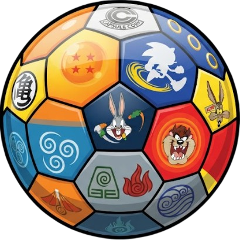 &nbsp;
  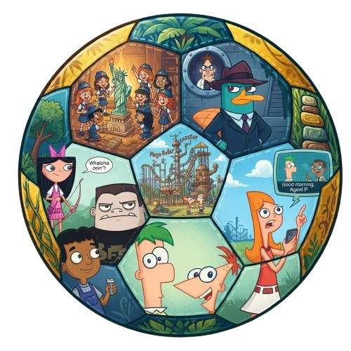 &nbsp;
  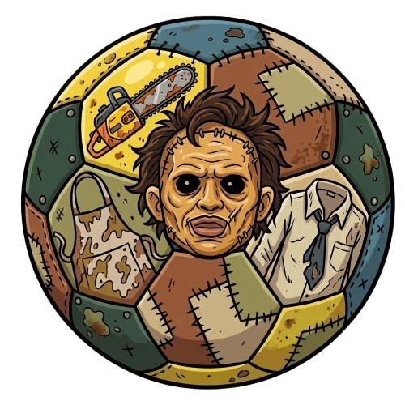
</p>

### Y más opciones

- **3 tamaños de arco** a elección.
- **Por tiempo (1, 2 o 3 minutos) o por goles (5, 7 o 10)**. Si hay empate al final del tiempo, se define en **muerte súbita**.
- **Vida y patadas que duelen**: cada patada al rival le quita vida, y los jugadores no pueden atravesarse.

<p align="center">
  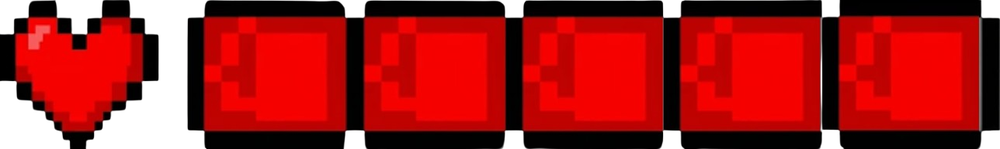 &nbsp;  &nbsp; 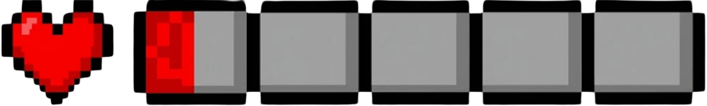
  <br><i>La barra de vida, de llena a casi vacía</i>
</p>

## 🛒 La tienda de mejoras

Cada partido deja puntos: **100 para el ganador y 25 para el perdedor**. Gástalos en la tienda y sube hasta el nivel 10 en:

<table align="center">
  <tr>
    <td align="center"><br>🏃 <b>Speed</b><br>Caminas más rápido</td>
    <td align="center"><br>🦘 <b>Jump</b><br>Saltas más alto</td>
    <td align="center"><br>🦵 <b>Kick</b><br>Patadas y poderes con más daño</td>
    <td align="center"><br>❤️ <b>Survival</b><br>Más vida</td>
  </tr>
</table>

<p align="center">
  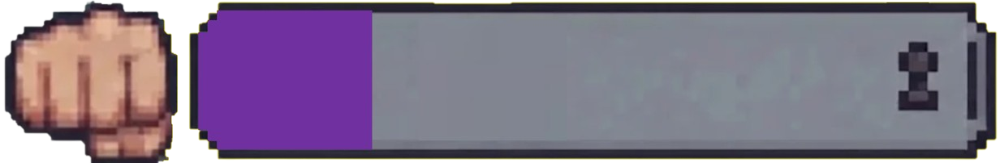 &nbsp; 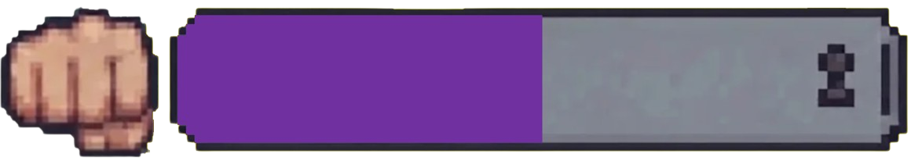 &nbsp; 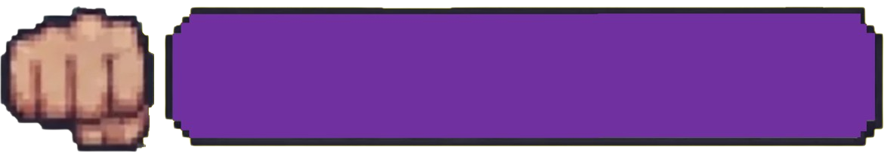
  <br><i>La barra de Kick: nivel 1, 5 y 10</i>
</p>

Los precios se duplican en cada nivel (500, 1000, 2000...), así que cada mejora hay que pensarla.

<p align="center">
  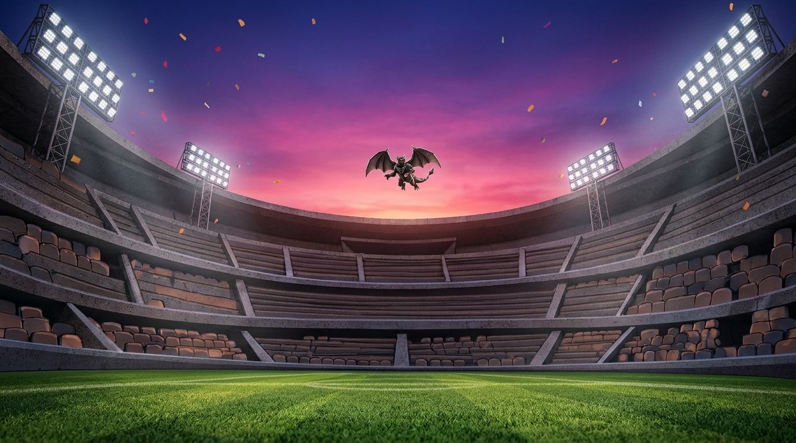
</p>

## 🏆 El podio

Al terminar el partido, el ganador sube al podio. Si le ganas a la máquina, la que celebra es ella.

<table align="center">
  <tr>
    <td align="center">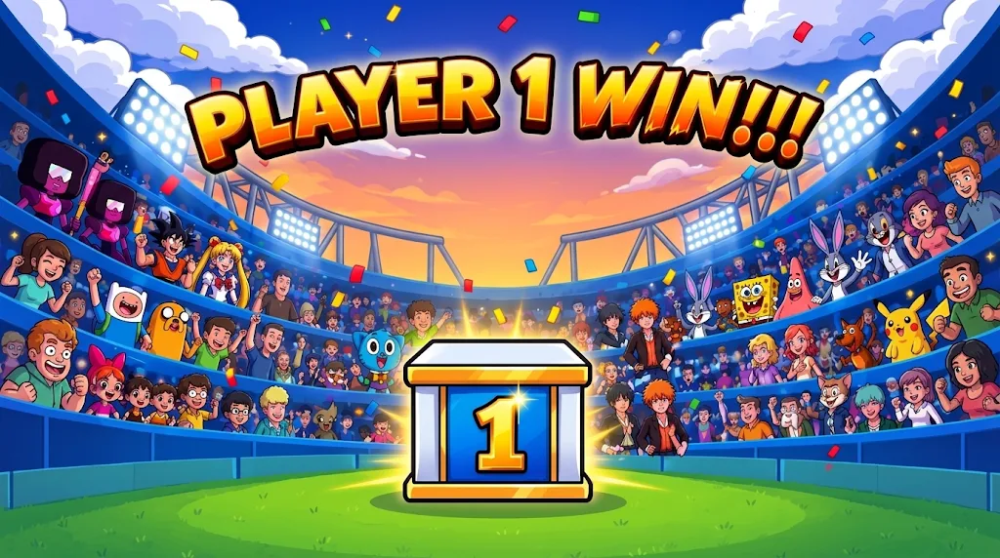<br><b>Gana el jugador 1</b></td>
    <td align="center">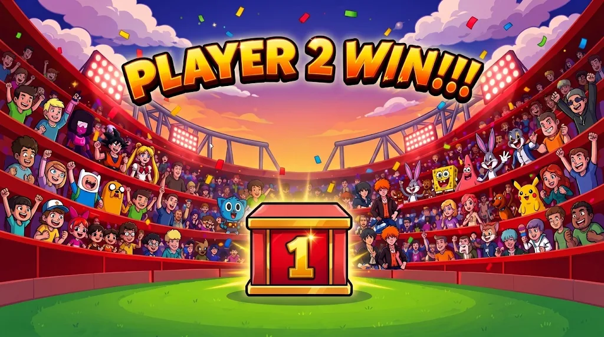<br><b>Gana el jugador 2</b></td>
    <td align="center">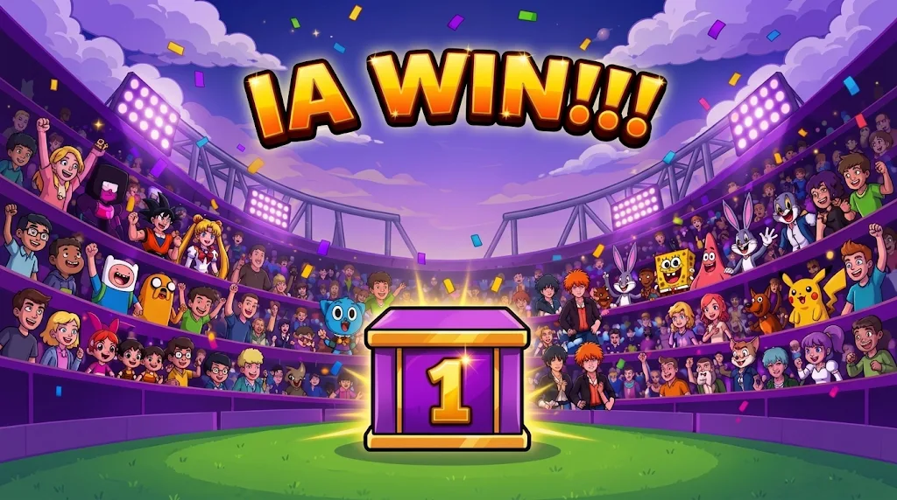<br><b>Gana la máquina</b></td>
  </tr>
</table>

## 💾 Nunca pierdes tu progreso

- Tus **puntos y mejoras** se guardan solos en `progress.dat`.
- Desde el menú **Game** puedes **guardar un partido** en un archivo `.poob` y **abrirlo después** justo donde lo dejaste, con marcador, reloj, posiciones, vida y balón.

## ⌨️ Controles

| Acción | Jugador 1 | Jugador 2 |
|--------|:---------:|:---------:|
| Izquierda | `A` | `←` |
| Derecha | `D` | `→` |
| Saltar | `W` | `↑` |
| Patear | `S` | `↓` |
| Poder | `Q` | `Ctrl` derecho |

`Esc` sale del partido. El botón de pausa está junto al marcador.

## 🚀 Cómo ejecutarlo

Necesitas el **JDK de Java 17 o superior**. Desde la carpeta del proyecto:

```bash
javac -d bin src/domain/*.java src/presentation/*.java
java -cp bin presentation.PoobSoccerGUI
```

> Ejecútalo siempre desde la raíz del proyecto: las imágenes y la música se cargan desde `lib/` con rutas relativas.

## 🧪 Pruebas

Más de 150 pruebas con **JUnit 4** cubren los partidos, la física del balón, los goles, los cuatro poderes, el aturdimiento, el final del partido, la tienda, la persistencia y la máquina.

```bash
# Con los .jar de JUnit 4 y Hamcrest en la variable CP (en Linux y Mac el separador es ":")
javac -d bin -cp "bin;$CP" src/domain/*.java src/presentation/*.java src/tests/*.java
java -cp "bin;$CP" org.junit.runner.JUnitCore tests.MatchTest tests.BallTest tests.KickTest tests.GoalTest tests.PowerTest tests.BlueAuraTest tests.RayTest tests.TornadoTest tests.IllusionTest tests.StunTest tests.EndTest tests.TimerTest tests.LogTest tests.StatsTest tests.PersistenceTest tests.MachineTest
```

## 🧱 Cómo está hecho

El proyecto separa el dominio de la presentación:

```
src/
├── domain/         Lógica del juego, sin nada de Swing
├── presentation/   Una pantalla (vista) por clase
└── tests/          Pruebas unitarias
lib/                Imágenes y música
```

- **`PoobSoccer`** es la clase principal y un **singleton**: la presentación solo habla con el dominio a través de ella.
- **Polimorfismo en lugar de condicionales:** `Player` es abstracta, con `HumanPlayer` (teclado) y `AIPlayer` (máquina). `AIPlayer` también es abstracta y de ella heredan `Clumsy`, `Offensive`, `Defensive` y `Expert`.
- **Poderes** como interfaz `Power`, con una clase por cada poder.
- **Excepciones propias** (`PoobSoccerException`) con mensajes claros para el jugador, y un **log** (`POOBSoccer.log`) para los errores inesperados.
- **Persistencia** con serialización de Java.

## 👥 Autores

Hecho con mucho café por **Forero J.** y **Salinas S.**

<p align="center">
  <br>
  <i>¿Listo para el saque inicial? 🏆</i>
</p>
